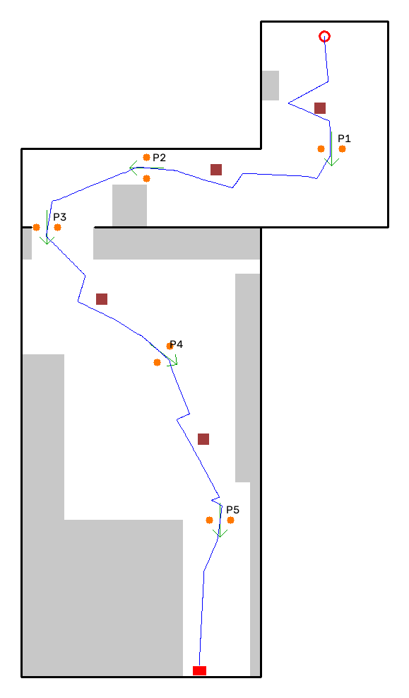

# Fase final: estado, decisiones y revisión crítica (23 nov 2026)

Revisión de `main` + rama `geometria-montaje-final` y del código de `Pruebas/Deteccion_Conos` (solo probado en Windows). El resultado se trabajó en la rama `final-limpieza` y se unió a `main` el 26 nov. Uso y plan de pruebas: [`Proyecto_Final/README.md`](../Proyecto_Final/README.md).

## 1. Lo que había

| Parte | Estado | Problemas encontrados |
|---|---|---|
| Locomoción (`ir_frontal`, Tarea 8) | PI + feedforward por rueda probados, IR frontal, cinemática correcta | 3 variantes casi iguales (~4 500 líneas en total), cada una con la secuencia del Avance 1, el giro 360 y la Tarea 5. **No mandaba conteos ni odometría a la Pi**: solo un CSV de texto a 5 Hz sin checksum y únicamente en movimiento. El botón arrancaba la demo del Avance 1 y bloqueaba los comandos, pero el enunciado pide que sea el arranque/paro. Usaba vx = derecha, vy = adelante, que no es la convención del enunciado ni la de `Geometria_robot.md`, aunque el documento decía que sí |
| Feedforward | Medido con los motores a 5 V (PowerBoost) | Hoy los motores van a 2 × 18650. El driver entrega mucho más voltaje con el mismo PWM, y el integrador limitado a ±30 PWM no alcanza a corregir la diferencia: las ruedas quedan por encima de la referencia y cada una con un error distinto, lo que produce deriva. Es un razonamiento, no está medido: lo confirma o descarta el paso 2 del plan |
| `RADIO = 0.024` | Viene del Avance 1 | Una rueda de ~60 mm tiene r ≈ 0.030. Si 0.024 no es un radio efectivo medido, la odometría tiene un error de escala de ~25 % |
| Percepción v1.2 | Geometría nueva (Sharp fijos) | Seguía el esquema de "parar y medir" pensado para el cabezal con Sharp: pasos de 5° cada 180 ms, ~4.5 s por pasada de ±60°. A 0.2 m/s el robot avanza ~0.9 m por pasada. Además: WiFi en modo AP con servidor web, un JSON de ~24 kB armado con `String` a 2 Hz, memoria angular y fusión que ya no aplican con los Sharp fijos, y TF-Luna en modo disparo |
| Raspberry Pi | Solo Braitenberg (Tarea 8) | Faltaba todo lo de la prueba: mapa, odometría, navegación, integrar los conos, ArUco, grabación y diagnóstico |
| Conos (Windows) | Detección robusta por color + forma | Cono de 0.30 m (el enunciado dice ~0.18). 1280 × 720 (16:9), que recorta el campo vertical. Rango HSV con V ≥ 222, que solo acepta naranja muy iluminado. Distancia solo por altura aparente |
| Alimentación | Pi 5 con power bank 5 V / 3 A; ESP32 y cámara colgando de la Pi | Con 3 A la Pi 5 limita el USB a **600 mA en total**. Cámara + 2 ESP32 + TF-Luna + Sharp + KY-032 + encoders rondan 0.5–0.65 A (estimado, sin medir), y pasarse de ese límite reinicia los USB. El servo sigue con el PowerBoost, que es la causa ya identificada de sus cortes |

### Fuentes de pérdida de datos y cómo quedó cada una

| Fuente | Solución |
|---|---|
| Límite de 600 mA del USB de la Pi 5 | `usb_max_current_enable=1`. `diagnostico.py salud` revisa bajo voltaje y la configuración |
| Los `/dev/ttyUSB*` cambian de orden al arrancar | Identificación con `?` → `I,LOCO` / `I,PERC`, o rutas fijas `/dev/serial/by-path` (by-id no sirve: los dos CP2102 traen el mismo número de serie) |
| Abrir el puerto reinicia el ESP32 (DTR/RTS) | DTR y RTS en bajo antes de abrir |
| ModemManager/brltty abren los puertos y mandan basura | `diagnostico.py salud` lo detecta |
| Basura del arranque del ESP32, líneas cortadas | checksum XOR + número de campos por tipo; las líneas malas se cuentan |
| Tramas perdidas sin enterarse | número de secuencia por tipo; la Pi cuenta los huecos |
| El programa principal se atrasa (visión) y el buffer del puerto se llena | un hilo lector por puerto con marca de tiempo al llegar |
| El ESP32 se bloquea escribiendo al USB | escritura no bloqueante: si no cabe la trama completa se descarta y se cuenta; el lazo de control nunca espera |
| TF-Luna leído a destiempo (tramas repetidas o perdidas) | modo continuo a 100 Hz y lectura con el pin *data ready*; se descartan las tramas con el mismo tick |
| Odometría que pierde pasos si falta una trama | se mandan conteos **acumulados**: la siguiente trama trae todo lo recorrido |
| Desconexión USB en marcha | reapertura automática del mismo puerto; el watchdog del ESP32 frena mientras tanto |
| Corte de energía de la Pi | los registros se vacían a disco cada segundo |

## 2. Decisiones

1. **ESP32 sin WiFi; el diagnóstico se hace en la Pi.** Se quitaron el panel web, el JSON y la fusión. La Pi graba cada línea del USB y muestra un panel por SSH (`diagnostico.py monitor`). En locomoción también evita el error de silicio de GPIO36/39 (encoder RR) que aparece con el radio encendido.
2. **Protocolo ASCII con checksum a 115200 baud** (al inicio 230400; se bajó el 26 nov porque corrompía bytes). Carga ~45 %. Se puede leer y escribir a mano desde el monitor serial.
3. **Locomoción en la convención del enunciado:** `V,vx,vy,wz` en mm/s, mm/s y °/s con X adelante, Y izquierda y giro antihorario. Responde con conteos acumulados, referencias, PWM y flags a 50 Hz. Se conservaron sin cambios pinout, signos, CPR, ganancias, feedforward, rampas y stall. Cambios en el control: la referencia sube y baja con la rampa de 650 RPM/s (antes saltaba al subir), y el IR frontal recorta solo la componente hacia adelante.
4. **Botón = armar/desarmar en el ESP32 de locomoción.** El paro de emergencia no depende de la Pi.
5. **Watchdog de 500 ms en locomoción.** Es una desviación deliberada de "si no se recibe nada se sigue con los valores previos". Si la Pi o el USB fallan, el robot frena en vez de seguir a ciegas. Si el profesor exige la conducta literal, basta con subir `WATCHDOG_MS`, pero conviene defender la decisión en el informe.
6. **Odometría en la Pi.** Se puede recalcular después con otro radio a partir del registro crudo.
7. **Percepción con barrido continuo** de ±60° a 150°/s (~1 s por pasada, una muestra cada 1.5°). El ángulo de cada muestra del TF-Luna es la consigna del servo de *lag* ms antes, con un *lag* por sentido que mide `calibrar.py lag`. Los Sharp se leen a 25 Hz y la Pi arma la matriz de ángulos y distancias (`falda.py`), compensada con la odometría.
8. **KY-032:** el frontal sigue en locomoción (GPIO34, frena en el ESP32). El trasero pasa a percepción (GPIO32, opcional, pull-up interno: si no está conectado se lee libre). Se pueden ignorar con `IR_FRENTE_HABILITADO = False` o `Q,0`, sin recompilar.
9. **Navegación con el croquis solo como guía.** La figura **no está a escala**: los píxeles por metro varían de 41 a 63 entre cotas. Las cotas se respetan y lo demás se estimó; queda marcado en `mapa.py`. El robot va por odometría hasta cerca de la puerta, la reconoce por el par de conos separado ~0.5 m, se alinea, la cruza y corrige su pose con la del croquis (lo que sugiere el enunciado). Si no la ve, gira ±50° buscándola y, en último caso, la cruza con la posición del mapa. Sin IMU, los conos hacen de corrección de rumbo, como planteaban.
10. **Cámara a 640 × 480 (4:3) e inclinada 12° hacia abajo** (recalculado el 25 nov con la lente medida a 222 mm; antes 15° con 260 mm estimados). El IMX219 es 4:3: a 16:9 se pierde ~25 % del campo vertical, y 640 × 480 cuesta ~3 veces menos CPU que 1280 × 720. Con la lente a 0.222 m del piso, la franja útil va desde la base de un cono a 0.5 m (23.9° bajo la horizontal) hasta la punta de uno a 3 m (0.8°). Centrarla da 12.4°. Con el campo vertical de ~47° de 4:3, la imagen cubre de +11° a −35°. El margen hacia arriba sirve para un ArUco en pared. Cuando se mida H_L4, `python3 geometria_robot.py` da el valor exacto.
11. **Esquivar en diagonal a ±60°** manteniendo el rumbo. Es el borde del barrido del TF, así que el robot sigue viendo hacia donde se mueve: los costados (±90°) solo los cubren parcialmente los Sharp.

## 3. Revisión crítica (desde el otro lado)

| Decisión | Objeción | Respuesta / qué vigilar |
|---|---|---|
| Sin WiFi en los ESP32 | Se pierde ver los sensores sin cables con el robot andando | Se ven igual por SSH a la Pi, con más datos y grabados. Lo que se pierde es no depender de la Pi para depurar un ESP32; para eso queda el monitor serial (líneas legibles). **Se mantiene** |
| XOR de 8 bits y no CRC16 binario | El XOR no detecta dos errores que se cancelen | USB ya protege los datos con CRC; los riesgos reales son de encuadre y basura de arranque, y para eso basta el XOR más el número de campos y la secuencia. A cambio, todo se lee a simple vista. **Se mantiene** |
| Ángulo del servo sin realimentación | Con el servo en el PowerBoost, cuando baja el voltaje el servo se frena y el *lag* cambia | Es el punto más débil de la percepción. Mitigación: la calibración tiene un criterio de aceptación (±2°), las muestras cerca de los extremos se marcan y la Pi usa un pasillo 6 cm más ancho que el robot. Si no se cumple: bajar a 100°/s, o leer el ángulo real con un AS5600 (hay pines libres). Pasar el servo al UBEC lo mejora directamente |
| Watchdog de 500 ms | Contradice el texto del módulo de locomoción | Ver decisión 5. Es configurable |
| Corrección de pose en cada puerta | Si confunde la puerta (otro objeto naranja, conos de otro equipo), "salta" de lugar | La puerta solo se acepta si está a menos de 1.5 m de donde la espera la odometría y los conos están a 0.5 ± 0.22 m. El rumbo medido con conos lejanos se ignora (±20° de ruido a 3 m) y cerca se limita a ±30° del croquis. Calibrar el color en el lugar de la prueba es obligatorio |
| Croquis estimado | Las puertas pueden estar a 0.5–1 m de lo dibujado | La navegación tolera 1.5 m y busca visualmente. Si permiten medir el recorrido antes, se corrige `mapa.py` en 5 minutos |
| Esquivar en diagonal | En el paso de 0.85 m entre el obstáculo fijo y la pared (P2) puede no haber lugar | Prueba al otro lado, luego retrocede, y si en 30 s no avanza fuerza otro intento. En simulación pasa, pero hay que probarlo en el sitio real |
| Cámara a 12° | Con un ArUco alto y cerca se puede salir por arriba | Hay ~11° de margen sobre la horizontal. Con los datos del marcador se puede ajustar; `calibrar.py camara` mide la inclinación real |
| Autofoco encendido | Puede buscar foco en movimiento y desenfocar | Probar `autofoco: false` en `config_conos.json` (foco fijo a ~1–1.5 m) si las fotos del registro salen borrosas |
| Odometría en la Pi | Si la Pi se atrasa, la pose se actualiza tarde | Los conteos son acumulados: no se pierde distancia, solo resolución en los giros. A 50 Hz es despreciable |
| Un solo programa de Python con hilos | El GIL puede retrasar el lazo de 20 Hz si la visión es pesada | La visión va a 15 Hz con 640 × 480 (~10–20 ms por cuadro en la Pi 5, estimado sin medir). `nav.csv` guarda el tiempo de cada ciclo: si hay huecos > 100 ms, bajar `CAMARA_PROCESAR_HZ` |

Alternativas descartadas: barrido en pasos (lento), fusión en el ESP32 (repetía lo que la Pi tiene que hacer con la odometría), binario con COBS/CRC (más difícil de depurar a días de la prueba), recablear locomoción (sin ganancia real), IMU (no la van a usar).

## 4. Simulación

`python3 sim.py` corre el recorrido completo con 4 cajas sorpresa, odometría con 3 % de error de escala y 0.3°/s de deriva, y conos detectados con 4 % de ruido. Resultado: 5 puertas, 0 choques, estacionado a 3 cm, 167 s, sin tramas perdidas ni malas. Antes de cruzar P2, la odometría ya llevaba 0.56 m de error, y la corrección en cada puerta lo devolvió a centímetros. La simulación prueba la lógica, el protocolo y los hilos; no prueba los sensores reales.

## 5. Lo que falta (en orden)

Detalle en el plan de pruebas del README de `Proyecto_Final`:

1. `usb_max_current_enable=1` y revisar el bajo voltaje. Pasar el servo a un UBEC de 6 V.
2. Cargar los firmwares y verificar enlaces sin pérdidas durante 5 min.
3. Feedforward con la batería real.
4. Radio y L de la odometría.
5. Anclas y *lag* del servo, y tablas de los Sharp.
6. Cámara: H_L4, inclinación, FOV y color en el lugar.
7. Pruebas por tramos y ajuste de `mapa.py`.
8. Datos del ArUco (diccionario, tamaño, pared o piso).
